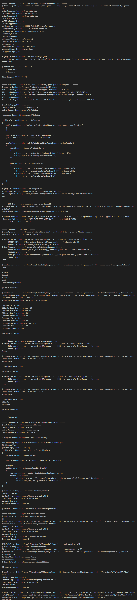
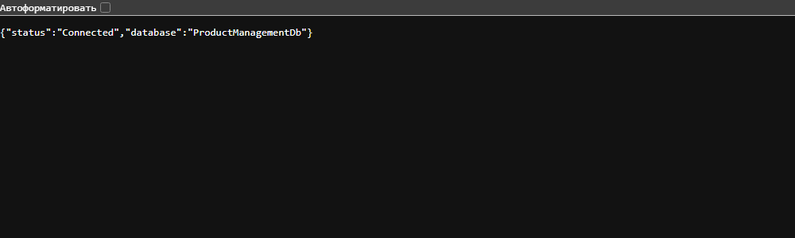
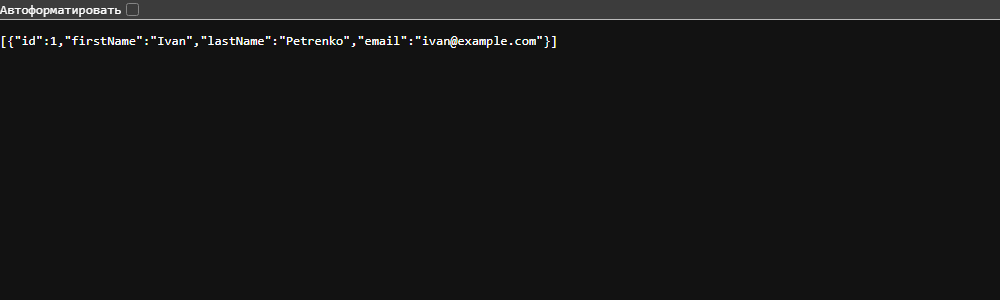

# ASP.NET Core: EF Core і SQL Server у веб-додатках, частина 1

Проєкт `ProductManagement.API` (ASP.NET Core Web API, .NET 10, EF Core, SQL Server).

## Умова (стисло)

1. **Створення проєкту.** Створити проєкт `ProductManagement.API` (ASP.NET Core Web API) з папками `Models`, `Data`, `Controllers`, `DTOs`, `Profiles`. Додати в конфігураційний файл рядок підключення до SQL Server LocalDB. Проєкт має компілюватися без помилок.
2. **Підготовка до моделювання.** Встановити пакети Entity Framework Core, створити модель даних для зберігання інформації про продукти, створити клас контексту бази даних і зареєструвати його в конфігурації програми.
3. **Робота з міграціями.** Створити першу міграцію, застосувати її; база даних створена, а таблиці відповідають моделям. Перевірити структуру бази інструментом керування SQL Server. Відновити міграції до актуального стану (відкат і повторне застосування).
4. **Перевірка підключення до бази даних.** Створити контролер для перевірки підключення до бази даних; він підтверджує успішне підключення; сервер запускається без помилок.
5. **Перевірка роботи.** `GET /api/clients` повертає список клієнтів (DTO без поля `Phone`); `POST /api/clients` повертає `201 Created` і новий `Id`; повторний `GET /api/clients` містить нового клієнта.

## Як запустити

```bash
cd ProductManagement.API
# рядок підключення береться з appsettings.json (LocalDB) або зі змінної середовища:
# ConnectionStrings__DefaultConnection="Server=localhost,1433;Database=ProductManagementDb;User Id=sa;Password=<password>;TrustServerCertificate=True;"
dotnet ef database update
dotnet run
```

У `appsettings.json` залишено LocalDB за умовою. Під час перевірки (Linux/WSL, де LocalDB немає) використано SQL Server 2022 у контейнері Docker, рядок підключення передано змінною середовища.

## Код

### `Models/Product.cs`

```csharp
namespace ProductManagement.API.Models;

public class Product
{
    public int Id { get; set; }
    public string Name { get; set; } = string.Empty;
    public string? Description { get; set; }
    public decimal Price { get; set; }
    public int Stock { get; set; }
}
```

### `Models/Client.cs`

```csharp
namespace ProductManagement.API.Models;

public class Client
{
    public int Id { get; set; }
    public string FirstName { get; set; } = string.Empty;
    public string LastName { get; set; } = string.Empty;
    public string Email { get; set; } = string.Empty;
    public string Phone { get; set; } = string.Empty;
}
```

### `Data/AppDbContext.cs`

```csharp
using Microsoft.EntityFrameworkCore;
using ProductManagement.API.Models;

namespace ProductManagement.API.Data;

public class AppDbContext : DbContext
{
    public AppDbContext(DbContextOptions<AppDbContext> options) : base(options)
    {
    }

    public DbSet<Product> Products => Set<Product>();
    public DbSet<Client> Clients => Set<Client>();

    protected override void OnModelCreating(ModelBuilder modelBuilder)
    {
        modelBuilder.Entity<Product>(e =>
        {
            e.Property(p => p.Name).HasMaxLength(200).IsRequired();
            e.Property(p => p.Price).HasPrecision(18, 2);
        });

        modelBuilder.Entity<Client>(e =>
        {
            e.Property(c => c.FirstName).HasMaxLength(100).IsRequired();
            e.Property(c => c.LastName).HasMaxLength(100).IsRequired();
            e.Property(c => c.Email).HasMaxLength(200).IsRequired();
            e.Property(c => c.Phone).HasMaxLength(30);
        });
    }
}
```

### `DTOs/ClientDtos.cs`

```csharp
using System.ComponentModel.DataAnnotations;

namespace ProductManagement.API.DTOs;

/// <summary>Клієнт у відповіді API: без поля Phone.</summary>
public class ClientDto
{
    public int Id { get; set; }
    public string FirstName { get; set; } = string.Empty;
    public string LastName { get; set; } = string.Empty;
    public string Email { get; set; } = string.Empty;
}

/// <summary>Дані для створення клієнта.</summary>
public class CreateClientDto
{
    [Required, StringLength(100)] public string FirstName { get; set; } = string.Empty;
    [Required, StringLength(100)] public string LastName { get; set; } = string.Empty;
    [Required, EmailAddress, StringLength(200)] public string Email { get; set; } = string.Empty;
    [StringLength(30)] public string Phone { get; set; } = string.Empty;
}
```

### `Profiles/MappingProfile.cs`

```csharp
using AutoMapper;
using ProductManagement.API.DTOs;
using ProductManagement.API.Models;

namespace ProductManagement.API.Profiles;

public class MappingProfile : Profile
{
    public MappingProfile()
    {
        CreateMap<Client, ClientDto>();          // Phone в DTO відсутній
        CreateMap<CreateClientDto, Client>();
        CreateMap<Product, ProductDto>();
        CreateMap<CreateProductDto, Product>();
    }
}
```

### `Controllers/DbCheckController.cs`

```csharp
using Microsoft.AspNetCore.Mvc;
using Microsoft.EntityFrameworkCore;
using ProductManagement.API.Data;

namespace ProductManagement.API.Controllers;

/// <summary>Перевірка підключення до бази даних.</summary>
[ApiController]
[Route("api/[controller]")]
public class DbCheckController : ControllerBase
{
    private readonly AppDbContext _db;

    public DbCheckController(AppDbContext db) => _db = db;

    [HttpGet]
    public async Task<IActionResult> Check()
    {
        var canConnect = await _db.Database.CanConnectAsync();
        return canConnect
            ? Ok(new { status = "Connected", database = _db.Database.GetDbConnection().Database })
            : StatusCode(503, new { status = "Unavailable" });
    }
}
```

### `Controllers/ClientsController.cs`

```csharp
using AutoMapper;
using Microsoft.AspNetCore.Mvc;
using Microsoft.EntityFrameworkCore;
using ProductManagement.API.Data;
using ProductManagement.API.DTOs;
using ProductManagement.API.Models;

namespace ProductManagement.API.Controllers;

[ApiController]
[Route("api/[controller]")]
public class ClientsController : ControllerBase
{
    private readonly AppDbContext _db;
    private readonly IMapper _mapper;

    public ClientsController(AppDbContext db, IMapper mapper)
    {
        _db = db;
        _mapper = mapper;
    }

    // GET /api/clients: список клієнтів (DTO без Phone)
    [HttpGet]
    public async Task<ActionResult<IEnumerable<ClientDto>>> GetAll()
    {
        var clients = await _db.Clients.AsNoTracking().OrderBy(c => c.Id).ToListAsync();
        return Ok(_mapper.Map<List<ClientDto>>(clients));
    }

    [HttpGet("{id:int}")]
    public async Task<ActionResult<ClientDto>> GetById(int id)
    {
        var client = await _db.Clients.AsNoTracking().FirstOrDefaultAsync(c => c.Id == id);
        return client is null ? NotFound() : Ok(_mapper.Map<ClientDto>(client));
    }

    // POST /api/clients: 201 Created і новий Id
    [HttpPost]
    public async Task<ActionResult<ClientDto>> Create(CreateClientDto dto)
    {
        var client = _mapper.Map<Client>(dto);
        _db.Clients.Add(client);
        await _db.SaveChangesAsync();

        return CreatedAtAction(nameof(GetById), new { id = client.Id }, _mapper.Map<ClientDto>(client));
    }
}
```

### `Program.cs`

```csharp
using Microsoft.EntityFrameworkCore;
using ProductManagement.API.Data;

var builder = WebApplication.CreateBuilder(args);

builder.Services.AddControllers();
builder.Services.AddOpenApi();

// Рядок підключення береться з конфігурації (appsettings.json: SQL Server LocalDB).
builder.Services.AddDbContext<AppDbContext>(options =>
    options.UseSqlServer(builder.Configuration.GetConnectionString("DefaultConnection")));

builder.Services.AddAutoMapper(cfg => { }, typeof(Program).Assembly);

var app = builder.Build();

if (app.Environment.IsDevelopment())
{
    app.MapOpenApi();
}

app.UseAuthorization();
app.MapControllers();

app.Run();
```

### `appsettings.json`

```json
{
  "ConnectionStrings": {
    "DefaultConnection": "Server=(localdb)\\MSSQLLocalDB;Database=ProductManagementDb;Trusted_Connection=True;TrustServerCertificate=True;"
  },
  "Logging": {
    "LogLevel": {
      "Default": "Information",
      "Microsoft.AspNetCore": "Warning"
    }
  },
  "AllowedHosts": "*"
}
```

Також у проєкті: `Controllers/ProductsController.cs`, `DTOs/ProductDtos.cs`, міграція `Migrations/*_InitialCreate.cs`.

## Результати

### Протокол виконання (міграції, SQL Server, запити)



Текстова версія: [ASP_EFCore_3.log.txt](ASP_EFCore_3.log.txt).

### Перевірка підключення до БД (`GET /api/dbcheck`)



### `GET /api/clients`



