# Docker: практичні завдання

Виконано на Docker Engine в WSL (Ubuntu). Для кожної практики: умова, протокол виконання команд (текстові файли в `logs/`) і скриншоти.

## Практика 1. Інсталяція Docker

### Умова

Встановити Docker на Ubuntu та перевірити, що він працює (версія, стан сервісу, `docker run hello-world`); відповісти на питання для закріплення.

### Результат

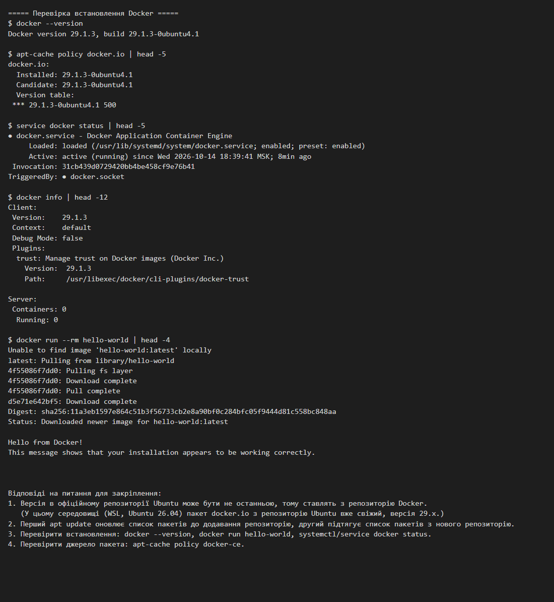

Текстовий протокол: [Docker_1_Install.txt](logs/Docker_1_Install.txt)

## Практика 2. Базові команди Docker

### Умова

Запустити контейнер `hello-world`, проаналізувати результат, визначити розмір і дату створення образу (`docker images`).

### Результат

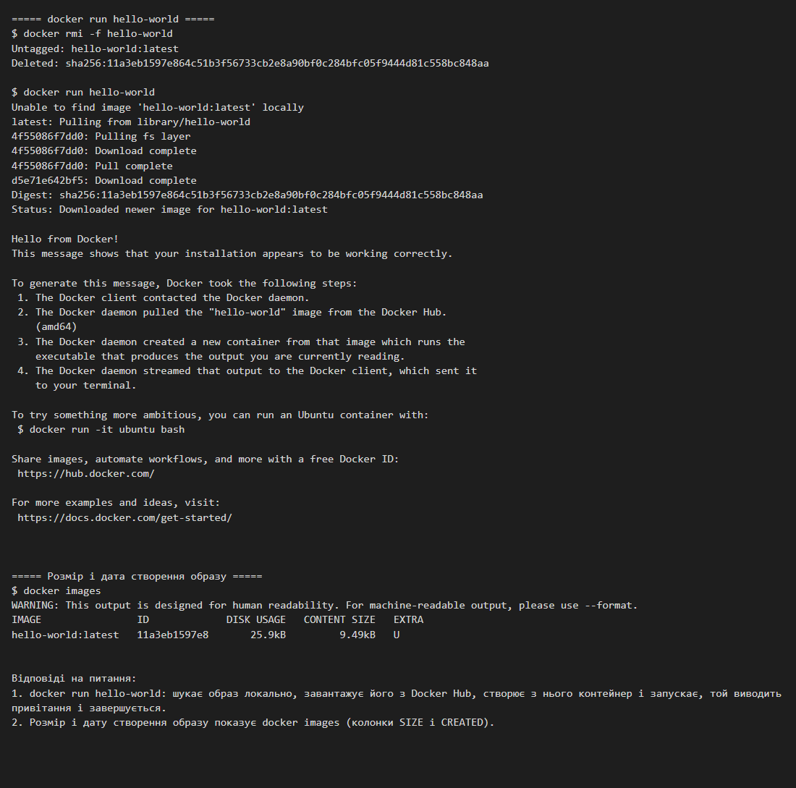

Текстовий протокол: [Docker_2_Basic_commands.txt](logs/Docker_2_Basic_commands.txt)

## Практика 3. Базові команди отримання інформації про образи

### Умова

`docker images`, `docker images -a`, завантажити образи `alpine:3.6 … 3.9` (`docker pull`), відфільтрувати образи (`--filter=reference`).

### Результат

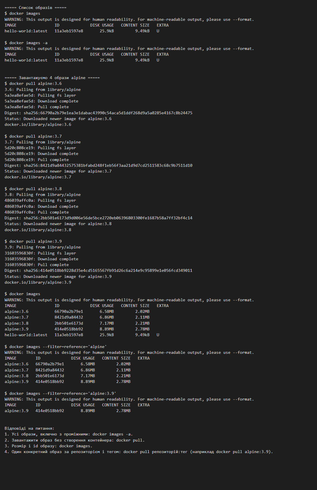

Текстовий протокол: [Docker_3_Images_info.txt](logs/Docker_3_Images_info.txt)

## Практика 4. Основи роботи з контейнерами, частина 1 (2.1)

### Умова

1) Запуск `hello-world`, `docker ps`/`ps -a`, статус, видалення. 2) Контейнер `alpine` у фоні з циклічним виведенням, логи, зупинка, видалення. 3) `nginx:alpine`, `docker exec`, перезапуск, зупинка/запуск, видалення.

### Результат

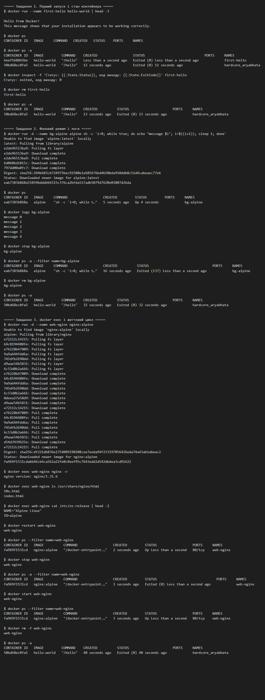

Текстовий протокол: [Docker_4_Containers_part1_2.1.txt](logs/Docker_4_Containers_part1_2.1.txt)

## Практика 5. Основи роботи з контейнерами, частина 2 (2.2)

### Умова

1) `docker search` nginx/redis/httpd. 2) `docker pull nginx:alpine` і `redis:alpine`, `docker images`. 3) Видалення образів і перевірка.

### Результат

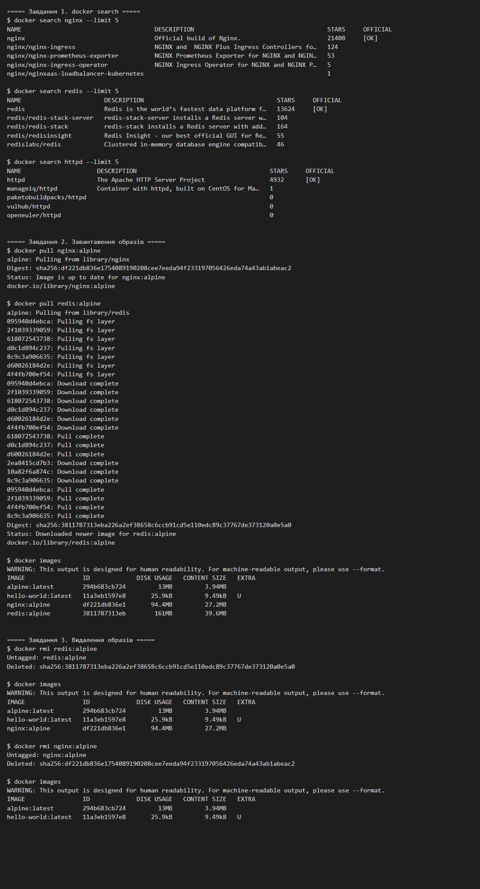

Текстовий протокол: [Docker_5_Images_part2_2.2.txt](logs/Docker_5_Images_part2_2.2.txt)

## Практика 6. Dockerfile, частина 1 (3.1)

### Умова

1) Образ статичного сайту (`nginx:alpine`, `static-site-image`, порт 8080:80). 2) Node.js/Express (`node-http-app-image`): `GET /` → `Hello from Docker!`, `GET /animal`. 3) Node.js зі змінною оточення `APP_MODE=development` (`node-env-app-image`), `GET /config`.

### Результат

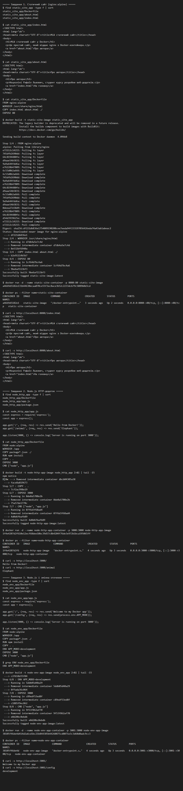

Текстовий протокол: [Docker_6_Dockerfile_3.1.txt](logs/Docker_6_Dockerfile_3.1.txt)

## Проєкти до практики 6

- [`static_site_app`](static_site_app): `index.html`, `about.html`, `Dockerfile`
- [`node_http_app`](node_http_app): `app.js`, `Dockerfile`
- [`node_env_app`](node_env_app): `app.js`, `Dockerfile`

### Сторінки в браузері

| | |
|---|---|
| 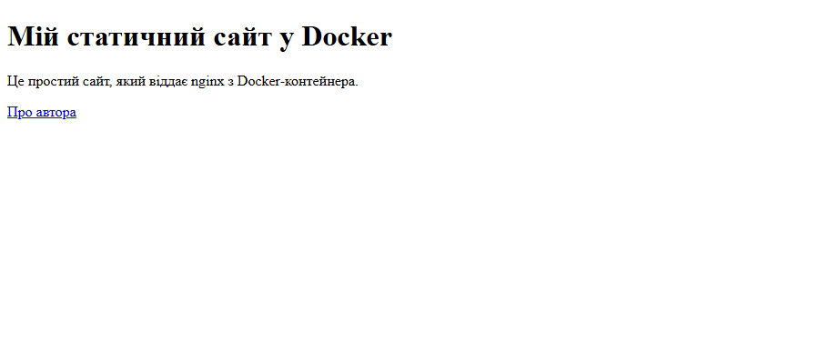 | 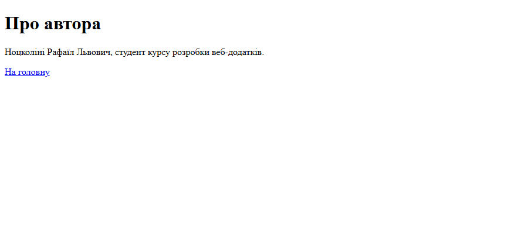 |
| 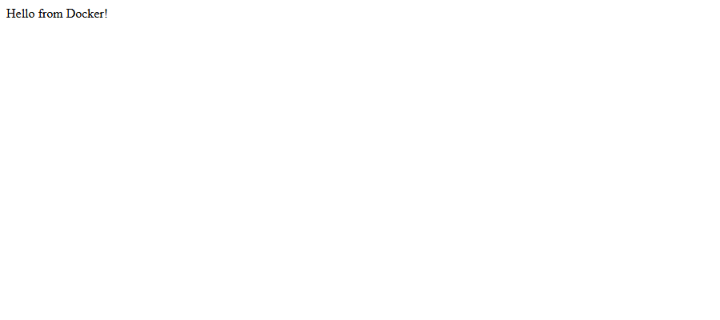 | 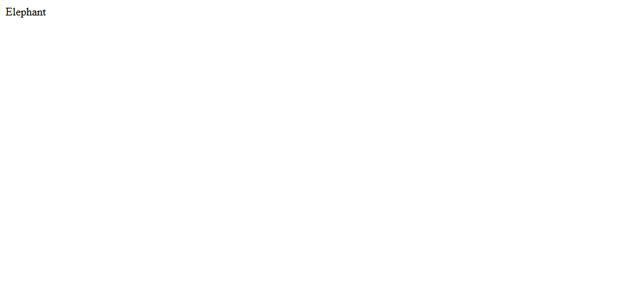 |
| 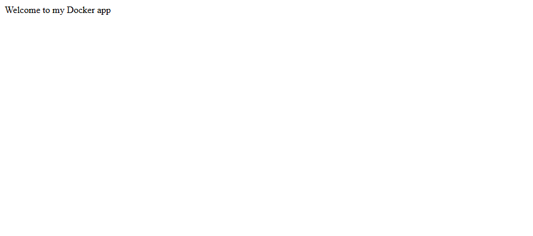 |  |

