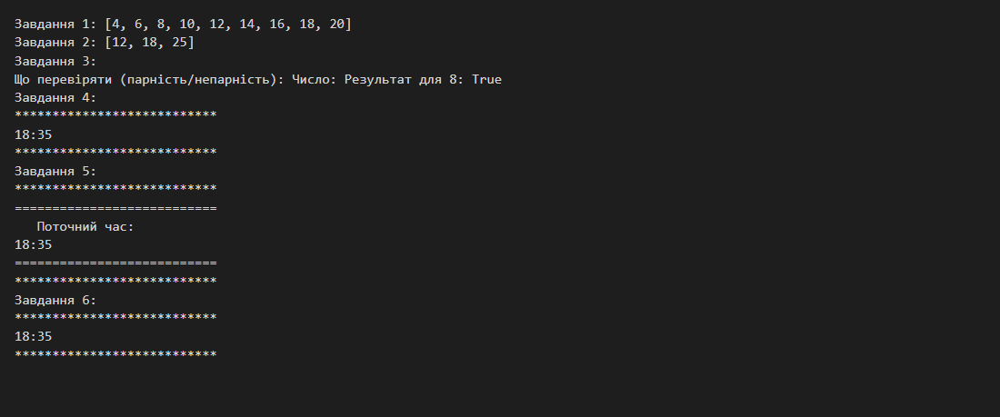
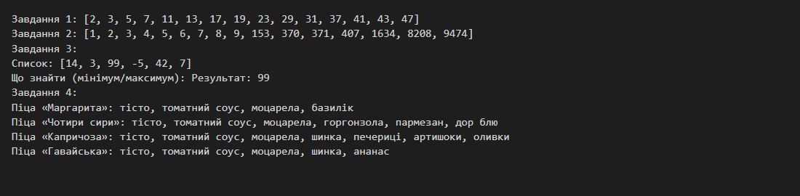
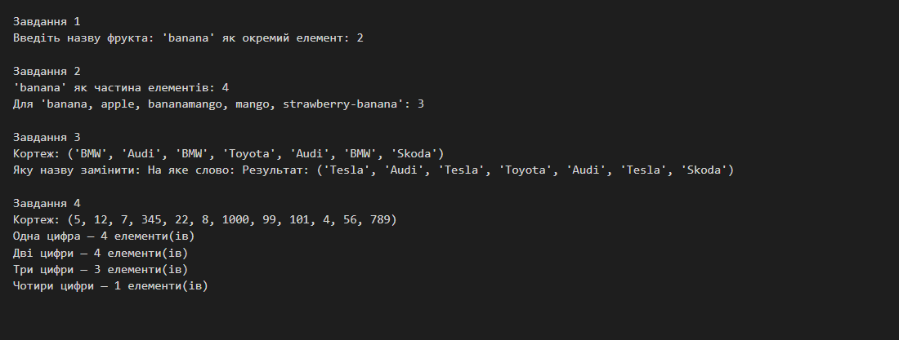
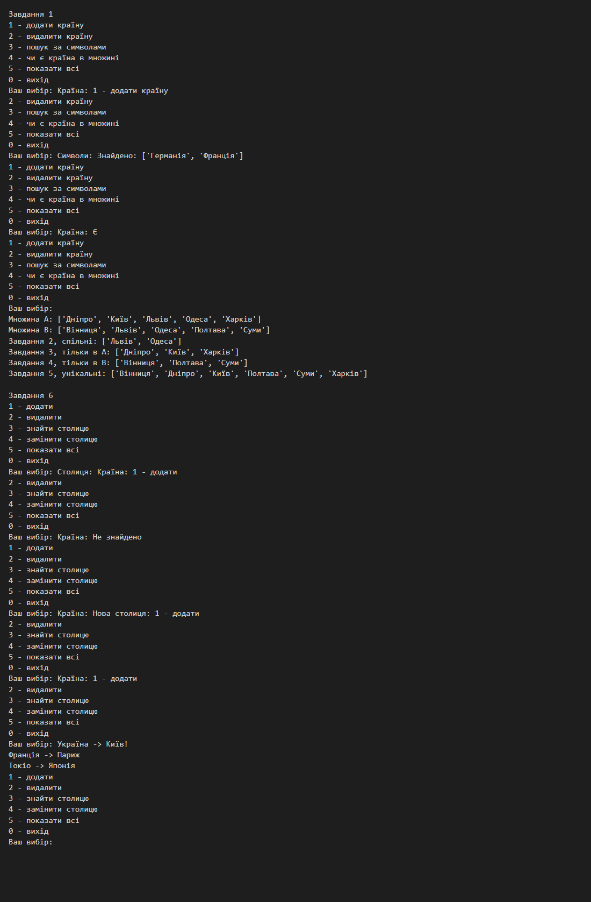
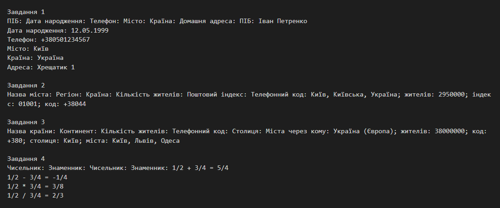
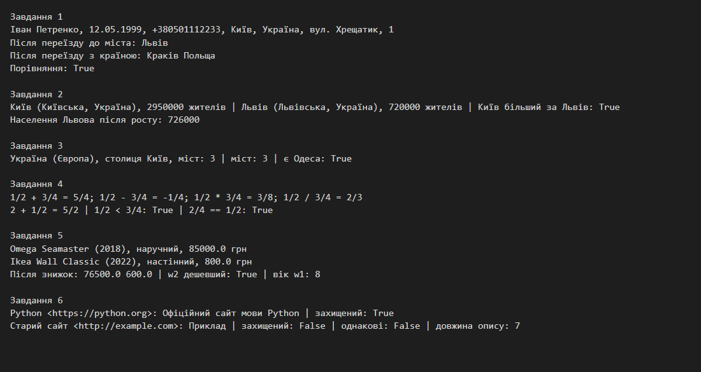

# Python: практичні завдання

Кожна практика: умова, код, результат запуску (скриншот). Код лежить у файлах `practice_*.py` цієї папки.

Запуск: `python practice_6_1_tuples.py` (потрібен Python 3.10+).

| Практика | Тема | Файл |
|---|---|---|
| 4.4 | Генератори, функції вищого порядку, декоратори. Частина 1 | [practice_4_4_generators_decorators_1.py](practice_4_4_generators_decorators_1.py) |
| 4.5 | Генератори, функції вищого порядку, декоратори. Частина 2 | [practice_4_5_generators_decorators_2.py](practice_4_5_generators_decorators_2.py) |
| 6.1 | Кортежі, множини, словники. Частина 1 | [practice_6_1_tuples.py](practice_6_1_tuples.py) |
| 6.2 | Кортежі, множини, словники. Частина 2 | [practice_6_2_sets_dicts.py](practice_6_2_sets_dicts.py) |
| 9.1 | ООП. Класи. Об'єкти | [practice_9_1_classes.py](practice_9_1_classes.py) |
| 9.2 | ООП. Конструктори. Перевантаження методів | [practice_9_2_constructors.py](practice_9_2_constructors.py) |

## Практика 4.4. Генератори, функції вищого порядку, декоратори. Частина 1

### Умова

1. Створіть функцію, яка повертає всі парні числа в діапазоні. Функція приймає початок і кінець діапазону як параметри. Використовуйте механізм генераторів усередині функції.
2. Створіть функцію, яка повертає всі значення зі списку, що знаходяться в діапазоні, зазначеному користувачем. Функція приймає список, початок і кінець діапазону як параметри. Використовуйте генератори.
3. Використовуючи функції вищого порядку, створіть функцію, яка перевіряє на парність або непарність передане число. Користувач визначає, на що перевіряти. Сигнатура: `def check_value(value_to_check, function_to_call)`.
4. Створіть функцію для відображення поточного часу. Не використовуючи синтаксис декораторів, виконайте декорування функції за допомогою іншої функції (виведення обрамлене рядками із зірочок).
5. До завдання 4 додайте ще одну функцію для декорування виведення даних, яка додає нові елементи форматування.
6. Виконайте завдання 4 з використанням синтаксису декораторів (`@`).

### Код ([practice_4_4_generators_decorators_1.py](practice_4_4_generators_decorators_1.py))

```python
"""Практичне завдання 4.4. Генератори, функції вищого порядку, декоратори, частина 1."""

from datetime import datetime


# Завдання 1
def even_numbers(start, end):
    """Генератор: усі парні числа в діапазоні [start, end]."""
    first = start if start % 2 == 0 else start + 1
    for n in range(first, end + 1, 2):
        yield n


# Завдання 2
def values_in_range(items, start, end):
    """Генератор: значення зі списку, що потрапляють у діапазон [start, end]."""
    for item in items:
        if start <= item <= end:
            yield item


# Завдання 3 (функції вищого порядку)
def is_even(value):
    return value % 2 == 0


def is_odd(value):
    return value % 2 != 0


def check_value(value_to_check, function_to_call):
    """Перевіряє значення переданою функцією (парність або непарність)."""
    return function_to_call(value_to_check)


# Завдання 4: декорування без синтаксису @
def show_time():
    print(datetime.now().strftime("%H:%M"))


def stars_decorator(func):
    def wrapper():
        print("*" * 27)
        func()
        print("*" * 27)
    return wrapper


# Завдання 5: ще один декоратор, який додає елементи форматування
def frame_decorator(func):
    def wrapper():
        print("=" * 27)
        print("   Поточний час:")
        func()
        print("=" * 27)
    return wrapper


# Завдання 6: синтаксис декораторів
@stars_decorator
def show_time_with_syntax():
    print(datetime.now().strftime("%H:%M"))


def main():
    print("Завдання 1:", list(even_numbers(3, 20)))
    print("Завдання 2:", list(values_in_range([5, 12, 7, 30, 18, 2, 25], 10, 26)))

    print("Завдання 3:")
    choice = input("Що перевіряти (парність/непарність): ").strip().lower() or "парність"
    func = is_even if choice.startswith("пар") else is_odd
    value = int(input("Число: ") or 7)
    print(f"Результат для {value}: {check_value(value, func)}")

    print("Завдання 4:")
    decorated = stars_decorator(show_time)
    decorated()

    print("Завдання 5:")
    stars_decorator(frame_decorator(show_time))()

    print("Завдання 6:")
    show_time_with_syntax()


if __name__ == "__main__":
    main()
```

### Результат



## Практика 4.5. Генератори, функції вищого порядку, декоратори. Частина 2

### Умова

1. Створіть функцію, яка повертає всі прості числа в діапазоні (початок і кінець — параметри). Використовуйте генератори.
2. Створіть функцію, яка повертає всі числа Армстронга в діапазоні (початок і кінець — параметри). Використовуйте генератори.
3. Використовуючи функції вищого порядку, створіть функцію, яка знаходить мінімум або максимум у списку. Сигнатура: `def find_min_or_max(list_to_check, function_to_call)`.
4. Створіть додаток із випікання піци. Використовуючи декоратори, створіть піци: Маргарита, Чотири сири, Капричоза, Гавайська.

### Код ([practice_4_5_generators_decorators_2.py](practice_4_5_generators_decorators_2.py))

```python
"""Практичне завдання 4.5. Генератори, функції вищого порядку, декоратори, частина 2."""


# Завдання 1
def primes_in_range(start, end):
    """Генератор: усі прості числа в діапазоні [start, end]."""
    for n in range(max(start, 2), end + 1):
        if all(n % d for d in range(2, int(n ** 0.5) + 1)):
            yield n


# Завдання 2
def armstrong_numbers(start, end):
    """Генератор: числа Армстронга в діапазоні [start, end]."""
    for n in range(max(start, 1), end + 1):
        digits = str(n)
        if n == sum(int(d) ** len(digits) for d in digits):
            yield n


# Завдання 3 (функції вищого порядку)
def find_min(items):
    result = items[0]
    for item in items[1:]:
        if item < result:
            result = item
    return result


def find_max(items):
    result = items[0]
    for item in items[1:]:
        if item > result:
            result = item
    return result


def find_min_or_max(list_to_check, function_to_call):
    return function_to_call(list_to_check)


# Завдання 4: піца, збирається декораторами
def pizza_base():
    return ["тісто", "томатний соус"]


def with_ingredients(*ingredients):
    """Декоратор-фабрика: додає інгредієнти до піци."""
    def decorator(func):
        def wrapper():
            return func() + list(ingredients)
        return wrapper
    return decorator


def named(name):
    """Декоратор: підписує піцу назвою та виводить склад."""
    def decorator(func):
        def wrapper():
            ingredients = func()
            print(f"Піца «{name}»: {', '.join(ingredients)}")
            return ingredients
        return wrapper
    return decorator


@named("Маргарита")
@with_ingredients("моцарела", "базилік")
def margherita():
    return pizza_base()


@named("Чотири сири")
@with_ingredients("моцарела", "горгонзола", "пармезан", "дор блю")
def four_cheeses():
    return pizza_base()


@named("Капричоза")
@with_ingredients("моцарела", "шинка", "печериці", "артишоки", "оливки")
def capricciosa():
    return pizza_base()


@named("Гавайська")
@with_ingredients("моцарела", "шинка", "ананас")
def hawaiian():
    return pizza_base()


def main():
    print("Завдання 1:", list(primes_in_range(1, 50)))
    print("Завдання 2:", list(armstrong_numbers(1, 10000)))

    print("Завдання 3:")
    numbers = [14, 3, 99, -5, 42, 7]
    print("Список:", numbers)
    choice = input("Що знайти (мінімум/максимум): ").strip().lower() or "мінімум"
    func = find_min if choice.startswith("мін") else find_max
    print("Результат:", find_min_or_max(numbers, func))

    print("Завдання 4:")
    for pizza in (margherita, four_cheeses, capricciosa, hawaiian):
        pizza()


if __name__ == "__main__":
    main()
```

### Результат



## Практика 6.1. Кортежі, множини, словники. Частина 1

### Умова

1. Користувач вводить назву фрукта. Виведіть кількість фруктів, що містяться в кортежі як елемент.
2. Додайте підрахунок кількості, коли назва фрукта є частиною елемента (наприклад, «banana, apple, bananamango, mango, strawberry-banana» — «banana» трапляється три рази).
3. Є кортеж з назвами автовиробників. Користувач вводить назву виробника та слово для заміни. Замініть у кортежі всі елементи з цією назвою (збіг лише повний).
4. Є кортеж із цілими числами. Виведіть статистику за кількістю цифр в елементах (одна цифра — N елементів, дві — M тощо).

### Код ([practice_6_1_tuples.py](practice_6_1_tuples.py))

```python
"""Практичне завдання 6.1. Кортежі (завдання 1-4)."""

FRUITS = ("banana", "apple", "bananamango", "mango", "strawberry-banana", "banana", "kiwi")
CARS = ("BMW", "Audi", "BMW", "Toyota", "Audi", "BMW", "Skoda")
NUMBERS = (5, 12, 7, 345, 22, 8, 1000, 99, 101, 4, 56, 789)


def count_exact(items, name):
    """Завдання 1: скільки разів назва зустрічається як окремий елемент кортежу."""
    return items.count(name)


def count_inside(items, name):
    """Завдання 2: скільки разів назва зустрічається як частина елементів
    (рахуємо кожне входження, в тому числі кілька в одному елементі)."""
    return sum(item.count(name) for item in items)


def replace_in_tuple(items, old, new):
    """Завдання 3: кортеж незмінний, тому будуємо новий. Збіг лише повний."""
    return tuple(new if item == old else item for item in items)


def digits_statistics(numbers):
    """Завдання 4: скільки елементів з однією, двома, трьома... цифрами."""
    stats = {}
    for n in numbers:
        digits = len(str(abs(n)))
        stats[digits] = stats.get(digits, 0) + 1
    return dict(sorted(stats.items()))


def main():
    print("Завдання 1")
    fruit = input("Введіть назву фрукта: ").strip() or "banana"
    print(f"'{fruit}' як окремий елемент: {count_exact(FRUITS, fruit)}")

    print("\nЗавдання 2")
    print(f"'{fruit}' як частина елементів: {count_inside(FRUITS, fruit)}")
    print("Для 'banana, apple, bananamango, mango, strawberry-banana':",
          count_inside(("banana", "apple", "bananamango", "mango", "strawberry-banana"), "banana"))

    print("\nЗавдання 3")
    print("Кортеж:", CARS)
    old = input("Яку назву замінити: ").strip() or "BMW"
    new = input("На яке слово: ").strip() or "Tesla"
    print("Результат:", replace_in_tuple(CARS, old, new))

    print("\nЗавдання 4")
    print("Кортеж:", NUMBERS)
    words = {1: "Одна цифра", 2: "Дві цифри", 3: "Три цифри", 4: "Чотири цифри"}
    for digits, count in digits_statistics(NUMBERS).items():
        print(f"{words.get(digits, str(digits) + ' цифр')} — {count} елементи(ів)")


if __name__ == "__main__":
    main()
```

### Результат



## Практика 6.2. Кортежі, множини, словники. Частина 2

### Умова

1. Є множина з назвами країн. Дайте користувачеві змогу додавати країни, видаляти, шукати за введеними символами та перевіряти, чи міститься країна в множині.
2. Є дві множини з назвами міст. Створіть третю множину з назвами, які є в обох множинах.
3. Створіть третю множину з назвами, які є в першій множині, але відсутні у другій.
4. Створіть третю множину з назвами, які є в другій множині, але відсутні в першій.
5. Створіть третю множину з унікальними назвами для кожної множини.
6. У словнику зберігається набір пар «країна → столиця». Реалізуйте додавання, видалення, пошук, заміну.

### Код ([practice_6_2_sets_dicts.py](practice_6_2_sets_dicts.py))

```python
"""Практичне завдання 6.2. Множини та словники (завдання 1-6)."""

CITIES_A = {"Київ", "Львів", "Одеса", "Харків", "Дніпро"}
CITIES_B = {"Львів", "Одеса", "Полтава", "Вінниця", "Суми"}


def countries_menu(countries):
    """Завдання 1: додавання, видалення, пошук за символами, перевірка наявності."""
    menu = ("1 - додати країну\n2 - видалити країну\n3 - пошук за символами\n"
            "4 - чи є країна в множині\n5 - показати всі\n0 - вихід")
    while True:
        print(menu)
        choice = input("Ваш вибір: ").strip()
        if choice == "1":
            countries.add(input("Країна: ").strip())
        elif choice == "2":
            name = input("Країна: ").strip()
            if name in countries:
                countries.remove(name)
            else:
                print("Такої країни немає")
        elif choice == "3":
            part = input("Символи: ").strip().lower()
            found = sorted(c for c in countries if part in c.lower())
            print("Знайдено:", found if found else "нічого")
        elif choice == "4":
            print("Є" if input("Країна: ").strip() in countries else "Немає")
        elif choice == "5":
            print(sorted(countries))
        elif choice == "0" or choice == "":
            break


def common(a, b):
    """Завдання 2: назви, які є в обох множинах."""
    return a & b


def only_first(a, b):
    """Завдання 3: є в першій, немає в другій."""
    return a - b


def only_second(a, b):
    """Завдання 4: є в другій, немає в першій."""
    return b - a


def unique_for_each(a, b):
    """Завдання 5: унікальні для кожної множини (симетрична різниця)."""
    return a ^ b


def capitals_menu(capitals):
    """Завдання 6: словник «країна -> столиця»: додавання, видалення, пошук, заміна."""
    menu = ("1 - додати\n2 - видалити\n3 - знайти столицю\n4 - замінити столицю\n"
            "5 - показати всі\n0 - вихід")
    while True:
        print(menu)
        choice = input("Ваш вибір: ").strip()
        if choice == "1":
            capitals[input("Країна: ").strip()] = input("Столиця: ").strip()
        elif choice == "2":
            if capitals.pop(input("Країна: ").strip(), None) is None:
                print("Такої країни немає")
        elif choice == "3":
            country = input("Країна: ").strip()
            print(capitals.get(country, "Не знайдено"))
        elif choice == "4":
            country = input("Країна: ").strip()
            if country in capitals:
                capitals[country] = input("Нова столиця: ").strip()
            else:
                print("Такої країни немає")
        elif choice == "5":
            for country, capital in capitals.items():
                print(f"{country} -> {capital}")
        elif choice == "0" or choice == "":
            break


def main():
    print("Завдання 1")
    countries_menu({"Україна", "Польща", "Франція", "Італія"})

    print("\nМножина A:", sorted(CITIES_A))
    print("Множина B:", sorted(CITIES_B))
    print("Завдання 2, спільні:", sorted(common(CITIES_A, CITIES_B)))
    print("Завдання 3, тільки в A:", sorted(only_first(CITIES_A, CITIES_B)))
    print("Завдання 4, тільки в B:", sorted(only_second(CITIES_A, CITIES_B)))
    print("Завдання 5, унікальні:", sorted(unique_for_each(CITIES_A, CITIES_B)))

    print("\nЗавдання 6")
    capitals_menu({"Україна": "Київ", "Польща": "Варшава", "Франція": "Париж"})


if __name__ == "__main__":
    main()
```

### Результат



## Практика 9.1. ООП. Класи. Об'єкти

### Умова

1. Реалізуйте клас «Людина»: ПІБ, дата народження, контактний телефон, місто, країна, домашня адреса; методи введення-виведення та інші операції.
2. Створіть клас «Місто»: назва, регіон, країна, кількість жителів, поштовий індекс, телефонний код; методи введення-виведення та інші операції.
3. Створіть клас «Країна»: назва, континент, кількість жителів, телефонний код, столиця, міста; методи введення-виведення та інші операції.
4. Створіть клас «Дріб»: чисельник і знаменник; методи введення-виведення та арифметичні операції (додавання, віднімання, множення, ділення).

### Код ([practice_9_1_classes.py](practice_9_1_classes.py))

```python
"""Практичне завдання 9.1. Класи та об'єкти (завдання 1-4)."""

from math import gcd


class Person:
    """Завдання 1: Людина."""

    def __init__(self):
        self.full_name = ""
        self.birth_date = ""
        self.phone = ""
        self.city = ""
        self.country = ""
        self.address = ""

    def input_data(self):
        self.full_name = input("ПІБ: ")
        self.birth_date = input("Дата народження: ")
        self.phone = input("Телефон: ")
        self.city = input("Місто: ")
        self.country = input("Країна: ")
        self.address = input("Домашня адреса: ")

    def print_data(self):
        print(f"ПІБ: {self.full_name}\nДата народження: {self.birth_date}\n"
              f"Телефон: {self.phone}\nМісто: {self.city}\nКраїна: {self.country}\n"
              f"Адреса: {self.address}")

    def age(self, today_year=2026):
        """Додаткова операція: вік за роком у кінці дати (дд.мм.рррр)."""
        return today_year - int(self.birth_date.split(".")[-1])


class City:
    """Завдання 2: Місто."""

    def __init__(self):
        self.name = ""
        self.region = ""
        self.country = ""
        self.population = 0
        self.postal_code = ""
        self.phone_code = ""

    def input_data(self):
        self.name = input("Назва міста: ")
        self.region = input("Регіон: ")
        self.country = input("Країна: ")
        self.population = int(input("Кількість жителів: "))
        self.postal_code = input("Поштовий індекс: ")
        self.phone_code = input("Телефонний код: ")

    def print_data(self):
        print(f"{self.name}, {self.region}, {self.country}; жителів: {self.population}; "
              f"індекс: {self.postal_code}; код: {self.phone_code}")

    def is_big(self):
        return self.population >= 1_000_000


class Country:
    """Завдання 3: Країна."""

    def __init__(self):
        self.name = ""
        self.continent = ""
        self.population = 0
        self.phone_code = ""
        self.capital = ""
        self.cities = []

    def input_data(self):
        self.name = input("Назва країни: ")
        self.continent = input("Континент: ")
        self.population = int(input("Кількість жителів: "))
        self.phone_code = input("Телефонний код: ")
        self.capital = input("Столиця: ")
        self.cities = [c.strip() for c in input("Міста через кому: ").split(",") if c.strip()]

    def print_data(self):
        print(f"{self.name} ({self.continent}); жителів: {self.population}; "
              f"код: {self.phone_code}; столиця: {self.capital}; міста: {', '.join(self.cities)}")

    def add_city(self, city):
        self.cities.append(city)


class Fraction:
    """Завдання 4: Дріб з арифметичними операціями."""

    def __init__(self, numerator=0, denominator=1):
        self.numerator = numerator
        self.denominator = denominator

    def input_data(self):
        self.numerator = int(input("Чисельник: "))
        self.denominator = int(input("Знаменник: "))
        if self.denominator == 0:
            raise ValueError("Знаменник не може бути нулем")

    def print_data(self):
        print(f"{self.numerator}/{self.denominator}")

    def reduce(self):
        d = gcd(self.numerator, self.denominator) or 1
        return Fraction(self.numerator // d, self.denominator // d)

    def add(self, other):
        return Fraction(self.numerator * other.denominator + other.numerator * self.denominator,
                        self.denominator * other.denominator).reduce()

    def subtract(self, other):
        return Fraction(self.numerator * other.denominator - other.numerator * self.denominator,
                        self.denominator * other.denominator).reduce()

    def multiply(self, other):
        return Fraction(self.numerator * other.numerator,
                        self.denominator * other.denominator).reduce()

    def divide(self, other):
        if other.numerator == 0:
            raise ZeroDivisionError("Ділення на нуль")
        return Fraction(self.numerator * other.denominator,
                        self.denominator * other.numerator).reduce()


def main():
    print("Завдання 1")
    p = Person()
    p.input_data()
    p.print_data()

    print("\nЗавдання 2")
    c = City()
    c.input_data()
    c.print_data()

    print("\nЗавдання 3")
    country = Country()
    country.input_data()
    country.print_data()

    print("\nЗавдання 4")
    a, b = Fraction(), Fraction()
    a.input_data()
    b.input_data()
    for sign, result in (("+", a.add(b)), ("-", a.subtract(b)),
                         ("*", a.multiply(b)), ("/", a.divide(b))):
        print(f"{a.numerator}/{a.denominator} {sign} {b.numerator}/{b.denominator} = ", end="")
        result.print_data()


if __name__ == "__main__":
    main()
```

### Результат



## Практика 9.2. ООП. Конструктори. Перевантаження методів

### Умова

1. До класу «Людина» додайте конструктор та необхідні перевантажені методи.
2. До класу «Місто» додайте конструктор та необхідні перевантажені методи.
3. До класу «Країна» додайте конструктор та необхідні перевантажені методи.
4. До класу «Дріб» додайте конструктор та необхідні перевантажені методи.
5. Реалізуйте клас «Годинник»: модель, виробник, рік випуску, ціна, тип; конструктор, методи введення-виведення, інші операції; перевантаження методів.
6. Реалізуйте клас «Вебсайт»: назва, адреса, опис; конструктор, методи введення-виведення, інші операції; перевантаження методів.

Примітка: у Python немає перевантаження методів за сигнатурою, тому воно реалізоване аргументами за замовчуванням, `functools.singledispatchmethod` та перевизначенням операторів (`__add__`, `__eq__`, `__lt__`, `__str__`).

### Код ([practice_9_2_constructors.py](practice_9_2_constructors.py))

```python
"""Практичне завдання 9.2. Конструктори та перевантаження методів (завдання 1-6).

У Python немає перевантаження за сигнатурою, тому емулюємо його стандартними
засобами: значення за замовчуванням, *args, functools.singledispatchmethod
та перевизначення операторів (__add__, __eq__, __str__ тощо).
"""

from functools import singledispatchmethod
from math import gcd


class Person:
    """Завдання 1: Людина з конструктором і перевантаженими методами."""

    def __init__(self, full_name="", birth_date="01.01.2000", phone="", city="", country="", address=""):
        self.full_name = full_name
        self.birth_date = birth_date
        self.phone = phone
        self.city = city
        self.country = country
        self.address = address

    def __str__(self):
        return f"{self.full_name}, {self.birth_date}, {self.phone}, {self.city}, {self.country}, {self.address}"

    def __eq__(self, other):
        return isinstance(other, Person) and (self.full_name, self.birth_date) == (other.full_name, other.birth_date)

    def __hash__(self):
        return hash((self.full_name, self.birth_date))

    @singledispatchmethod
    def move(self, destination):
        raise TypeError("Очікується місто (str) або (місто, країна)")

    @move.register
    def _(self, destination: str):
        self.city = destination

    @move.register
    def _(self, destination: tuple):
        self.city, self.country = destination


class City:
    """Завдання 2: Місто."""

    def __init__(self, name="", region="", country="", population=0, postal_code="", phone_code=""):
        self.name = name
        self.region = region
        self.country = country
        self.population = population
        self.postal_code = postal_code
        self.phone_code = phone_code

    def __str__(self):
        return f"{self.name} ({self.region}, {self.country}), {self.population} жителів"

    def __eq__(self, other):
        return isinstance(other, City) and (self.name, self.country) == (other.name, other.country)

    def __lt__(self, other):
        return self.population < other.population

    def grow(self, amount=1000):
        """Збільшує населення на amount (за замовчуванням 1000)."""
        self.population += amount


class Country:
    """Завдання 3: Країна."""

    def __init__(self, name="", continent="", population=0, phone_code="", capital="", cities=None):
        self.name = name
        self.continent = continent
        self.population = population
        self.phone_code = phone_code
        self.capital = capital
        self.cities = list(cities) if cities else []

    def __str__(self):
        return f"{self.name} ({self.continent}), столиця {self.capital}, міст: {len(self.cities)}"

    def __len__(self):
        return len(self.cities)

    def __contains__(self, city):
        return city in self.cities

    def __iadd__(self, city):
        self.cities.append(city)
        return self


class Fraction:
    """Завдання 4: Дріб; операції через перевантаження операторів."""

    def __init__(self, numerator=0, denominator=1):
        if denominator == 0:
            raise ValueError("Знаменник не може бути нулем")
        d = gcd(numerator, denominator) or 1
        sign = -1 if denominator < 0 else 1
        self.numerator = sign * numerator // d
        self.denominator = sign * denominator // d

    @staticmethod
    def _coerce(value):
        return value if isinstance(value, Fraction) else Fraction(int(value), 1)

    def __str__(self):
        return f"{self.numerator}/{self.denominator}"

    def __add__(self, other):
        o = self._coerce(other)
        return Fraction(self.numerator * o.denominator + o.numerator * self.denominator,
                        self.denominator * o.denominator)

    __radd__ = __add__

    def __sub__(self, other):
        o = self._coerce(other)
        return Fraction(self.numerator * o.denominator - o.numerator * self.denominator,
                        self.denominator * o.denominator)

    def __mul__(self, other):
        o = self._coerce(other)
        return Fraction(self.numerator * o.numerator, self.denominator * o.denominator)

    __rmul__ = __mul__

    def __truediv__(self, other):
        o = self._coerce(other)
        if o.numerator == 0:
            raise ZeroDivisionError("Ділення на нуль")
        return Fraction(self.numerator * o.denominator, self.denominator * o.numerator)

    def __eq__(self, other):
        o = self._coerce(other)
        return (self.numerator, self.denominator) == (o.numerator, o.denominator)

    def __lt__(self, other):
        o = self._coerce(other)
        return self.numerator * o.denominator < o.numerator * self.denominator

    def __float__(self):
        return self.numerator / self.denominator


class Watch:
    """Завдання 5: Годинник."""

    def __init__(self, model="", manufacturer="", year=2000, price=0.0, kind="наручний"):
        self.model = model
        self.manufacturer = manufacturer
        self.year = year
        self.price = price
        self.kind = kind

    @classmethod
    def from_input(cls):
        return cls(input("Модель: "), input("Виробник: "), int(input("Рік випуску: ")),
                   float(input("Ціна: ")), input("Тип (наручний, настінний...): "))

    def __str__(self):
        return f"{self.manufacturer} {self.model} ({self.year}), {self.kind}, {self.price} грн"

    def __eq__(self, other):
        return isinstance(other, Watch) and (self.model, self.manufacturer, self.year) == \
            (other.model, other.manufacturer, other.year)

    def __lt__(self, other):
        return self.price < other.price

    def discount(self, percent=10):
        """Знижка у відсотках (за замовчуванням 10)."""
        self.price = round(self.price * (100 - percent) / 100, 2)

    def age(self, current_year=2026):
        return current_year - self.year


class Website:
    """Завдання 6: Вебсайт."""

    def __init__(self, name="", address="", description=""):
        self.name = name
        self.address = address
        self.description = description

    @classmethod
    def from_input(cls):
        return cls(input("Назва: "), input("Адреса: "), input("Опис: "))

    def __str__(self):
        return f"{self.name} <{self.address}>: {self.description}"

    def __eq__(self, other):
        return isinstance(other, Website) and self.address == other.address

    def __hash__(self):
        return hash(self.address)

    def __len__(self):
        return len(self.description)

    def is_secure(self):
        return self.address.lower().startswith("https://")


def main():
    print("Завдання 1")
    p = Person("Іван Петренко", "12.05.1999", "+380501112233", "Київ", "Україна", "вул. Хрещатик, 1")
    print(p)
    p.move("Львів")
    print("Після переїзду до міста:", p.city)
    p.move(("Краків", "Польща"))
    print("Після переїзду з країною:", p.city, p.country)
    print("Порівняння:", p == Person("Іван Петренко", "12.05.1999"))

    print("\nЗавдання 2")
    kyiv, lviv = City("Київ", "Київська", "Україна", 2_950_000, "01001", "+38044"), City("Львів", "Львівська", "Україна", 720_000)
    print(kyiv, "|", lviv, "| Київ більший за Львів:", lviv < kyiv)
    lviv.grow()
    lviv.grow(5000)
    print("Населення Львова після росту:", lviv.population)

    print("\nЗавдання 3")
    ua = Country("Україна", "Європа", 38_000_000, "+380", "Київ", ["Київ", "Львів"])
    ua += "Одеса"
    print(ua, "| міст:", len(ua), "| є Одеса:", "Одеса" in ua)

    print("\nЗавдання 4")
    a, b = Fraction(1, 2), Fraction(3, 4)
    print(f"{a} + {b} = {a + b}; {a} - {b} = {a - b}; {a} * {b} = {a * b}; {a} / {b} = {a / b}")
    print("2 + 1/2 =", 2 + a, "| 1/2 < 3/4:", a < b, "| 2/4 == 1/2:", Fraction(2, 4) == a)

    print("\nЗавдання 5")
    w1 = Watch("Seamaster", "Omega", 2018, 85000.0, "наручний")
    w2 = Watch("Wall Classic", "Ikea", 2022, 800.0, "настінний")
    print(w1)
    print(w2)
    w1.discount()
    w2.discount(25)
    print("Після знижок:", w1.price, w2.price, "| w2 дешевший:", w2 < w1, "| вік w1:", w1.age())

    print("\nЗавдання 6")
    s1 = Website("Python", "https://python.org", "Офіційний сайт мови Python")
    s2 = Website("Старий сайт", "http://example.com", "Приклад")
    print(s1, "| захищений:", s1.is_secure())
    print(s2, "| захищений:", s2.is_secure(), "| однакові:", s1 == s2, "| довжина опису:", len(s2))


if __name__ == "__main__":
    main()
```

### Результат



